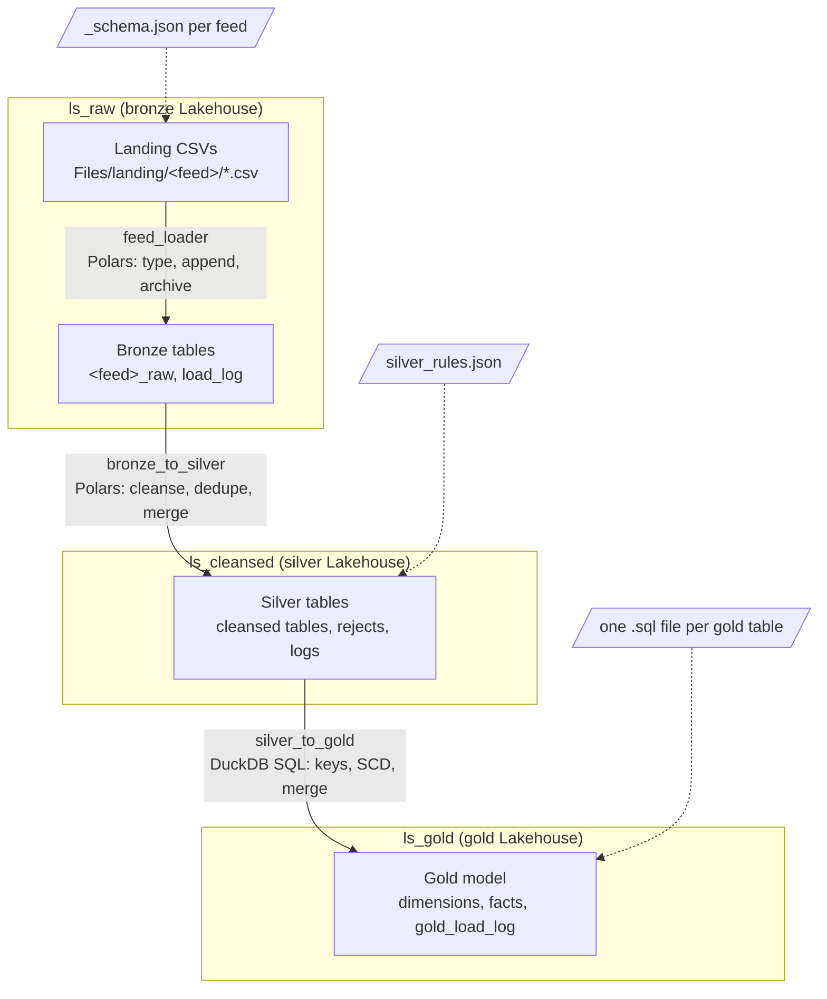
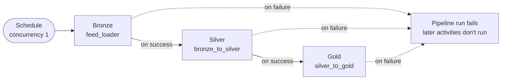
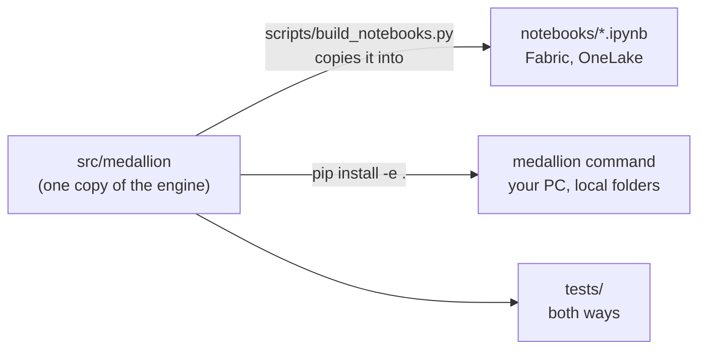

# Guide: medallion pipeline in Microsoft Fabric with Polars and DuckDB

Three Fabric **Python** notebooks take CSV files from a landing folder through bronze, silver and gold Delta tables without Spark. Each layer is driven by configuration files rather than code changes, and each is incremental: a run only processes what arrived since the last one.



| Notebook | Reads | Writes | Driven by |
| --- | --- | --- | --- |
| `feed_loader` (bronze) | CSV files in `Files/landing/<feed>/` | One raw Delta table per feed, plus `load_log` | A `_schema.json` per feed folder |
| `bronze_to_silver` (silver) | Bronze rows from files not yet processed | One cleansed table per bronze table, plus rejects and logs | `silver_rules.json` |
| `silver_to_gold` (gold) | Silver tables, and gold tables built earlier in the run | Dimensions and facts, plus `gold_load_log` | One `.sql` file per gold table |

Polars reads and transforms data in bronze and silver, DuckDB runs the gold SQL, and delta-rs (the `deltalake` package) writes every Delta table. Everything runs on the Python notebook's single node (2 vCores and 16 GB by default).

The same engine also runs on a PC with the `medallion` command, against local folders laid out like Lakehouses. See [Running on your PC](#running-on-your-pc).

Contents: [Setup](#setup) · [Bronze](#bronze-landing-csvs-to-raw-tables) · [Silver](#silver-cleansing-with-a-rules-file) · [Gold](#gold-dimensional-model-from-sql) · [Pipeline orchestration](#pipeline-orchestration) · [Operations](#operations) · [Sizing, limits and troubleshooting](#sizing-limits-and-troubleshooting) · [Running on your PC](#running-on-your-pc) · [Changing the engine](#changing-the-engine)

---

## Setup

### 1. Create the Lakehouses

In your workspace, create three Lakehouses with **Lakehouse schemas** enabled: `ls_raw` (bronze), `ls_cleansed` (silver) and `ls_gold` (gold). Other names work if you set the notebook parameters (and the deploy script's `--raw/--silver/--gold`) to match. With schemas off, set each notebook's schema parameter to `None`.

### 2. Deploy the configuration

Everything under `config/` mirrors where it goes in each Lakehouse:

```
config/ls_raw/Files/landing/<feed>/_schema.json   -> ls_raw:      Files/landing/<feed>/_schema.json
config/ls_cleansed/Files/config/silver_rules.json -> ls_cleansed: Files/config/silver_rules.json
config/ls_gold/Files/config/gold/*.sql            -> ls_gold:     Files/config/gold/*.sql
```

Deploy it with the script (signed in with `az login`, or as a service principal):

```bash
pip install -r requirements-deploy.txt
python scripts/deploy_to_onelake.py --workspace "<your workspace>" --dry-run   # see what will be uploaded
python scripts/deploy_to_onelake.py --workspace "<your workspace>" --data sample
```

`--data sample` also uploads the clean test CSVs to the landing folders; `--data dirty` uploads the messy set. Or upload the files by hand in the Lakehouse explorer (**... > Upload > Upload files**) into the same paths.

### 3. Import the notebooks

Import the notebooks in `notebooks/` (**Import > Notebook > From this computer**), or bring them in through Fabric Git integration (see [Fabric Git integration](FABRIC_GIT.md)). Open each one and check the language is **Python**, not PySpark. Attaching a Lakehouse is optional: the notebooks use full OneLake paths.

### 4. Set the parameters

Each notebook has a parameters cell near the top:

| Notebook | Parameter | Value |
| --- | --- | --- |
| `feed_loader` | `WORKSPACE`, `LAKEHOUSE` | your workspace name, `ls_raw` |
| `bronze_to_silver` | `SOURCE_WORKSPACE`, `SOURCE_LAKEHOUSE`, `TARGET_LAKEHOUSE` | your workspace name, `ls_raw`, `ls_cleansed` |
| `silver_to_gold` | `SILVER_WORKSPACE`, `SILVER_LAKEHOUSE`, `GOLD_LAKEHOUSE` | your workspace name, `ls_cleansed`, `ls_gold` |

Names are typed as they appear in Fabric; spaces are encoded for you. For Lakehouses in another workspace, set `TARGET_WORKSPACE` or `GOLD_WORKSPACE` too. In a pipeline, set these as the activity's base parameters instead.

### 5. First run

1. Deploy with `--data sample` (or upload the three `*_20261015.csv` files).
2. Run `feed_loader`: three bronze tables appear under `ls_raw` > Tables > dbo.
3. Run `bronze_to_silver` with `DRY_RUN = True`, check the counts, then with `DRY_RUN = False`.
4. Run `silver_to_gold` the same way.
5. Deploy with `--data dirty` and repeat steps 2 to 4 to see rejects, duplicates, SCD2 versions and incremental fact loads.

Each notebook's run cell prints the Polars, deltalake and DuckDB versions it found. Fabric Environments can't be attached to Python notebooks, so the optional `%pip install` cell at the top of each notebook is the way to pin versions. Pin Polars and deltalake together: mismatched eras fail on write.

---

## Bronze: landing CSVs to raw tables

The bronze notebook turns every child folder of `Files/landing` into a feed, loads each new CSV into the feed's table with strict types, and moves it to `Files/archive`. Adding a feed means adding a folder with a `_schema.json`; the notebook doesn't change.

**Per file**

1. **Duplicate check.** If the table already has rows from this file name, the file is archived without loading. A renamed copy of a loaded file loads again.
2. **Read and type.** Every column is read as text, trimmed, and cast to its type with strict parsing. A bad value fails the file with an error naming the column and value.
3. **Audit columns.** `_source_file` and `_load_ts` (UTC) are added.
4. **Append.** One Delta commit per file. Files of `STREAM_THRESHOLD_MB` (500) or more are streamed with `sink_delta`; on Polars versions without it they load in memory instead (`stream-fallback`).
5. **Archive.** The CSV moves to `archive/<feed>/`.

A failure stops that feed only: its file stays in landing, later files wait, other feeds carry on, and the run fails at the end so a pipeline sees it.

**The schema file**

```json
{
  "table": "orders_raw",
  "columns": {
    "order_id": "Int64",
    "customer_id": "Int32",
    "order_date": "Date",
    "amount": "Decimal(18,2)"
  },
  "formats": {"order_date": "%Y-%m-%d"},
  "csv_options": {"separator": ",", "has_header": true}
}
```

- `columns` (required): every CSV column in file order. Types: `String`, `Int8`–`Int64`, `UInt8`–`UInt64`, `Float32`, `Float64`, `Boolean` (true/false, 1/0, yes/no), `Date`, `Datetime` (stored as UTC, microseconds), `Decimal(p,s)`.
- `formats`: a parse format for every `Date` and `Datetime` column.
- `table` (optional): default is the folder name plus `_raw`.
- `csv_options` (optional): separator and header row.

Every schema file is checked before anything loads; an unknown type or a date column without a format stops the run.

**Parameters**

| Parameter | Default | Meaning |
| --- | --- | --- |
| `WORKSPACE`, `LAKEHOUSE`, `SCHEMA` | `MyWorkspace`, `MyLakehouse`, `dbo` | The raw Lakehouse |
| `LANDING_ROOT`, `ARCHIVE_ROOT` | `landing`, `archive` | Folders under Files |
| `FOLDER`, `TABLE` | empty | Load one folder (anywhere under Files) into a chosen table instead of discovering feeds |
| `FEED_FILTER` | empty | With discovery, only these feeds, e.g. `orders,products` |
| `MISSING_SCHEMA` | `skip` | Folder without `_schema.json`: `skip`, `fail`, or `text` (every column as text) |
| `DRY_RUN` | `False` | Read and validate every file; write and move nothing |
| `STREAM_THRESHOLD_MB` | `500` | Files this size or larger are streamed |
| `PARALLEL_FEEDS` | `1` | Feeds loaded at once on threads in the session |
| `ROW_GROUP_ROWS` | `8_000_000` | Max rows per Parquet row group (larger suits Direct Lake) |
| `LOG_TABLE` | `load_log` | Run log, one row per file; `None` turns it off |

---

## Silver: cleansing with a rules file

The silver notebook applies `silver_rules.json` to each bronze table and merges the result into a silver table named without `_raw`. It only reads bronze files it hasn't processed before.

**Per table**

1. **New files.** Bronze `_source_file` values not in `silver_processed_files` are grouped, oldest first, into batches of about `BATCH_ROWS` rows (a file is never split).
2. **Cleanse** each column with its rules, in order.
3. **Allowed values.** A failing value rejects its row, becomes null, or becomes a default.
4. **Duplicates.** Rows with a null key are rejected; repeated keys in a batch are resolved by `keep`.
5. **Write.** One commit per batch: a merge on the keys, or an append without keys.
6. **Record** rejects, processed files and counts. Batches committed before a failure keep their records.

**The rules file**

```json
{
  "tables": {
    "customers_raw": {
      "target_table": "customers",
      "duplicates": {"keys": ["customer_id"], "keep": "latest"},
      "cleanse": {
        "customer_name": ["remove_control_chars", "trim", "collapse_spaces", "null_if_empty", "title_case"],
        "country": ["trim", "null_if_empty", "title_case",
                    {"map": {"Uk": "United Kingdom", "U.K.": "United Kingdom", "Usa": "United States"}}]
      },
      "allowed_values": {
        "customer_name": {"allow_null": false, "on_fail": "reject"},
        "country": {"values": ["United Kingdom", "Ireland", "France", "United States"], "on_fail": "reject"}
      }
    },
    "orders_raw": {
      "duplicates": {"keys": ["order_id"]},
      "allowed_values": {
        "order_date": {"min": "2020-01-01", "max": "2026-12-31", "on_fail": "reject"},
        "amount": {"min": 0, "on_fail": "reject"}
      }
    }
  }
}
```

`duplicates`:

| `keep` | Within a batch | Key already in silver |
| --- | --- | --- |
| `latest` (default) | Newest bronze load wins (then later file, then later row) | Updated |
| `first` | Oldest wins | Left as it is |
| `reject` | Every row of a repeated key is rejected | Updated |

Without `duplicates`, rows are appended and nothing is deduplicated.

`cleanse` rules, applied in order:

| Rule | Columns | Effect |
| --- | --- | --- |
| `trim`, `upper`, `lower`, `title_case` | Text | Strip outer spaces; change case |
| `collapse_spaces` | Text | Runs of whitespace become one space |
| `remove_control_chars` | Text | Remove invisible control characters |
| `null_if_empty` | Text | Empty text becomes null |
| `{"replace": {"pattern": "regex", "with": "text"}}` | Text | Regex replace |
| `{"map": {"from": "to"}}` | Text | Exact-match value mapping |
| `abs`, `{"round": 2}` | Numeric | Absolute value; round |
| `{"fill_null": value}` | Any | Replace nulls |

`allowed_values` run after cleansing: any of `values`, `min`, `max`, `allow_null` (default `true`) and `ignore_case`. `on_fail` is `reject` (default), `null`, or `default` with `"default": value`. Dates are `YYYY-MM-DD`. Rules are checked against the bronze columns and types before any rows are read.

**Parameters**

| Parameter | Default | Meaning |
| --- | --- | --- |
| `SOURCE_LAKEHOUSE`, `TARGET_LAKEHOUSE` | `ls_raw`, `ls_cleansed` | Bronze and silver Lakehouses (plus `_WORKSPACE` and `_SCHEMA`) |
| `RULES_FILE` | `config/silver_rules.json` | Under Files in the silver Lakehouse |
| `TABLES` | empty | Every table in the rules file, or named ones |
| `FULL_RELOAD` | `False` | Rebuild from all bronze rows |
| `DRY_RUN` | `False` | Apply rules and report counts; write nothing |
| `BATCH_ROWS` | `10_000_000` | Rows per batch of new files |
| `PARALLEL_TABLES` | `1` | Tables processed at once |
| `LOG_TABLE`, `REJECTS_TABLE`, `PROCESSED_TABLE` | `silver_load_log`, `silver_rejects`, `silver_processed_files` | Bookkeeping tables |

Silver rows keep `_source_file` and `_load_ts` and add `_silver_updated_utc`, which gold uses for incremental loads.

---

## Gold: dimensional model from SQL

Each gold table is one `.sql` file in `Files/config/gold/`: `-- key: value` header lines, then a DuckDB `SELECT`. Silver tables are available as `silver.<table>` and gold tables as `gold.<table>`, including tables built earlier in the run. The notebook runs files in dependency order and handles keys, history and loading.

```sql
-- type: dimension
-- business_key: customer_id
-- surrogate_key: customer_sk
-- scd: 2
-- history_columns: country, region
SELECT c.customer_id, c.customer_name, COALESCE(c.country, 'Not known') AS country,
       CASE WHEN c.country IN ('United Kingdom', 'Ireland') THEN 'UK & Ireland' ELSE 'Rest of world' END AS region
FROM silver.customers AS c
```

| Header | For | Meaning |
| --- | --- | --- |
| `type` | both | `dimension` or `fact` (required) |
| `table` | both | Gold table name; default the file name |
| `business_key` | both | Column(s) identifying a row; required for dimensions and merged facts |
| `surrogate_key` | dimension | Integer key the notebook adds; default `<name>_sk`; `none` to use the business key only |
| `scd` | dimension | `1` (default) or `2` |
| `history_columns` | dimension | With `scd: 2`, columns whose changes create a new version (default all) |
| `unknown_member` | dimension | `true` (default) adds the -1 `Unknown` row |
| `load` | fact | `merge` (default with a key), `append`, or `overwrite` (default without one) |
| `depends_on` | both | Tables to build first; `gold.<table>` references are found automatically |
| `description` | both | Free text |

**Dimensions.** Surrogate keys are integers assigned on insert and never change. SCD1 overwrites changes. SCD2 closes the current row (`valid_to` = run time, `is_current` = false) and inserts a new version when a history column changes; other columns update the current row in place. A member's first version is valid from 1900-01-01; open versions run to 9999-12-31. Adding a column to the SQL adds it to the table without new versions; removing one stops the run.

**Facts** look up surrogate keys themselves, with `COALESCE(..., -1)` for no match (a null `_sk` column stops the load). For SCD2, join on the business key and the date:

```sql
-- type: fact
-- business_key: order_id
-- load: merge
SELECT o.order_id,
       COALESCE(c.customer_sk, -1) AS customer_sk,
       COALESCE(d.date_sk, -1)     AS order_date_sk,
       o.amount
FROM silver.orders AS o
LEFT JOIN gold.dim_customer AS c
       ON c.customer_id = o.customer_id AND o.order_date >= c.valid_from AND o.order_date < c.valid_to
LEFT JOIN gold.dim_date AS d ON d.date = o.order_date
WHERE o._silver_updated_utc > $watermark
```

`$watermark` is the start of the table's last successful run minus `WATERMARK_LOOKBACK_MINUTES` (60), or 1900-01-01 on a first run or full reload. A merge only rewrites rows whose values changed, so the overlap is harmless.

**Parameters**

| Parameter | Default | Meaning |
| --- | --- | --- |
| `SILVER_LAKEHOUSE`, `GOLD_LAKEHOUSE` | `ls_cleansed`, `ls_gold` | Source and target (plus `_WORKSPACE` and `_SCHEMA`) |
| `SQL_FOLDER` | `config/gold` | Under Files in the gold Lakehouse |
| `TABLES` | empty | Every SQL file, or named tables |
| `FULL_RELOAD` | `False` | `$watermark` = 1900-01-01; facts overwritten; dimensions keep keys and history |
| `DRY_RUN` | `False` | Run the SQL and report what would change |
| `WATERMARK_LOOKBACK_MINUTES` | `60` | Overlap for `$watermark` |
| `LOG_TABLE` | `gold_load_log` | One row per table per run |

If a table fails, tables that depend on it are skipped.

---

## Pipeline orchestration

Run the three notebooks from one Data Pipeline, each a Notebook activity that starts when the previous one succeeds. Schedule it and limit it to one run at a time.



1. Create a Data Pipeline with three **Notebook** activities: `feed_loader`, `bronze_to_silver`, `silver_to_gold`, joined with **On success**.
2. Under **Base parameters**, set values that differ from each parameters cell (they replace it at run time).
3. Add pipeline parameters for per-run switches and pass them through, e.g. `p_dry_run` → `DRY_RUN`.
4. Set the pipeline's concurrency to 1: two overlapping runs could both load the same landing file.
5. Schedule it at your feeds' cadence. A run with nothing new ends quickly.

Each notebook exits with a JSON summary including its run ID: `@activity('Bronze').output.result.exitValue`.

**Failures.** Every notebook finishes what it can, then raises an error naming each problem:

| Notebook | Still completes | Retried next run |
| --- | --- | --- |
| Bronze | Other feeds; earlier files of the failing feed | The failed file and later files of that feed |
| Silver | Other tables; batches committed before the failure | Files not in `silver_processed_files` |
| Gold | Tables not depending on the failed one | Everything since the table's last success |

**On completion** paths let healthy feeds flow through (silver only reads committed bronze files), but a handled failure can leave the pipeline run reported as successful: add a final check ending in a **Fail** activity or an alert. Retries are safe for keyed tables; keep them off for silver tables without keys and `append` facts.

**Parallel loads.** Inside one session, raise `PARALLEL_FEEDS` / `PARALLEL_TABLES` and add cores with `%%configure` (`{"vCores": 8}`). Across sessions, use a ForEach (Sequential off) passing `@item()` to `FEED_FILTER` or `TABLES`, never with the same feed or table in two items. Keep gold as one activity.

Event triggers (file arrival, preview) can fire more than once per upload; with them, concurrency 1 matters even more.

---

## Operations

| Table | Lakehouse | One row per | Use it for |
| --- | --- | --- | --- |
| `load_log` | `ls_raw` | File per bronze run | What landed, rows, timings, failures |
| `silver_load_log` | `ls_cleansed` | Table per silver run | Read, rejected, deduplicated, inserted, updated |
| `silver_rejects` | `ls_cleansed` | Rejected value or row | Why, with the original row as JSON |
| `silver_processed_files` | `ls_cleansed` | Bronze file per silver table | What silver has consumed |
| `gold_load_log` | `ls_gold` | Table per gold run | Rows, inserts, updates, versions, watermark |

All timestamps are UTC. Rejects by reason over 7 days, via the SQL analytics endpoint of `ls_cleansed`:

```sql
SELECT source_table, [column], reason, COUNT(*) AS rejects
FROM dbo.silver_rejects
WHERE rejected_utc > DATEADD(day, -7, SYSUTCDATETIME())
GROUP BY source_table, [column], reason
ORDER BY rejects DESC;
```

**Reloads**

| To | Do |
| --- | --- |
| Reload a bronze file | Upload it under a new file name |
| Rebuild a silver table after a rules change | Silver with `TABLES` = it and `FULL_RELOAD = True` |
| Rebuild facts (e.g. late-arriving customers) | Gold with `TABLES` = the fact and `FULL_RELOAD = True` |
| Remove a dimension column | Delete the gold table and run gold; keys are reassigned, so reload dependent facts |

**Maintenance.** Each notebook ends with a maintenance cell (`RUN_MAINTENANCE = True`) that compacts and vacuums its tables (7-day retention); on a PC, `medallion maintain <layer>` does the same. delta-rs can't write V-Order; run an occasional Spark `OPTIMIZE <table> VORDER` on gold if Direct Lake speed matters.

---

## Sizing, limits and troubleshooting

Memory is set by the largest single unit of work: one file in bronze, one batch in silver, one SQL result in gold. Measured outside Fabric on a 2-core machine:

| Layer | Unit | Peak memory |
| --- | --- | --- |
| Bronze, streamed (Polars 2.0) | 1 GB CSV, 30M rows | ~1.2–1.5 GB |
| Bronze, in memory (older Polars) | 1 GB CSV | ~3–4 GB |
| Silver | 10M rows (default `BATCH_ROWS`) | ~2.6 GB (~0.25 GB per million narrow rows) |
| Gold | One table's SQL result | Grows with the result |

A bronze file is never split in silver, so a file over ~50M rows needs a bigger session.

**Known limits.** Source deletes aren't propagated. A fact loaded before its dimension member exists keeps -1 until reprocessed. A new bronze column needs a silver `FULL_RELOAD`. Append-only tables can gain duplicates if a run is killed between write and bookkeeping. V-Order and liquid clustering need Spark.

| Symptom | Likely cause | Fix |
| --- | --- | --- |
| Table under Unidentified | Schemas on, `SCHEMA = None` | `SCHEMA = "dbo"` |
| Feed listed as `no schema` | No `_schema.json` in its folder | Deploy it; files wait in landing |
| `conversion from str to ... failed` | Value doesn't fit its type | Fix the file, type or date format |
| Silver reports `no new data` | Files already processed | Expected; `FULL_RELOAD` to rebuild |
| Many -1 keys in a fact | Lookup doesn't match | Check joins; for SCD2 use the date-bounded join |
| `business key not unique in the SQL result` | SQL returns several rows per key | Fix joins or the key |
| `SQL columns differ from gold.<table>` | Fact columns changed, or a dimension column removed | Facts: `FULL_RELOAD`; dimensions: see Reloads |
| Session restarts / out of memory | Unit of work too large | Lower `BATCH_ROWS` / `STREAM_THRESHOLD_MB`, or add vCores |


---

## Running on your PC

The notebooks' code lives in `src/medallion/` as a Python package, and the `medallion` command runs it on your own machine. Today it reads and writes **local folders** laid out exactly like the Fabric Lakehouses (`<name>.Lakehouse/Files` and `/Tables/dbo`); running locally against OneLake is the next step.



**Set up** (Windows PowerShell; the same on macOS or Linux with `source .venv/bin/activate`):

```powershell
cd C:\repos\fabric-polars-medallion\fabric-polars-medallion
python -m venv .venv
.venv\Scripts\Activate.ps1
pip install -e .
medallion init C:\lakehouses --data sample
```

`init` creates `ls_raw.Lakehouse`, `ls_cleansed.Lakehouse` and `ls_gold.Lakehouse` under the folder, copies `config/` into them (as the deploy script does for OneLake), and writes `medallion.json` with the Lakehouse names (`--raw`, `--silver`, `--gold` to change them). `--data sample` also copies the clean test CSVs into landing.

**Run:**

```powershell
cd C:\lakehouses                         # or pass --root C:\lakehouses, or set MEDALLION_ROOT
medallion run all                         # bronze, then silver, then gold; stops at the first failure
medallion run silver --dry-run
medallion run gold --tables fact_orders --full-reload
medallion run bronze --folder incoming/acme/orders --table acme_orders_raw
medallion run silver --set BATCH_ROWS=2000000
medallion deploy --data dirty --no-config # drop the messy test files into landing
medallion log silver -n 10                # recent runs; --table silver_rejects for rejects
medallion params gold                     # every parameter, default and meaning
```

| Option | Notebook parameter |
| --- | --- |
| `--dry-run` | `DRY_RUN = True` |
| `--full-reload` | `FULL_RELOAD = True` (silver, gold) |
| `--tables` | `TABLES` (silver: bronze table names; gold: gold table names) |
| `--feeds`, `--folder`, `--table` | `FEED_FILTER`, `FOLDER`, `TABLE` (bronze) |
| `--set NAME=VALUE` | any parameter; `--set gold.TABLES=dim_date` for one layer with `run all` |
| `--json` | print the notebook exit value(s) instead of tables |

Lakehouse and workspace parameters come from `medallion.json`. The exit code is 0 on success, 1 if a feed or table failed, and 2 for a configuration error. Tables written locally are ordinary Delta tables: open them with Polars (`pl.read_delta("C:/lakehouses/ls_gold.Lakehouse/Tables/dbo/fact_orders")`), DuckDB's `delta_scan`, or Power BI Desktop's Delta Lake connector.

After editing a schema file, the rules or a SQL file in `config/`, run `medallion deploy` to copy it into the local Lakehouses again (and `scripts/deploy_to_onelake.py` for Fabric).

**From Python**, call a layer directly:

```python
from medallion import LocalStorage
from medallion.silver import SilverParams, SilverRun

result = SilverRun(SilverParams(TABLES="customers_raw", DRY_RUN=True), LocalStorage("C:/lakehouses")).run()
result.summary          # the table the notebook shows
result.problems         # [] when everything worked
```

## Changing the engine

`src/medallion/` is the only copy of the code:

| Module | Contains |
| --- | --- |
| `common.py` | Shared helpers: streaming collect, write options, merge options, parameters and run results |
| `storage.py` | `FabricStorage` (OneLake from a notebook, via `notebookutils`) and `LocalStorage` (local folders) |
| `bronze.py` | `BronzeParams`, schema files, `BronzeRun` |
| `silver.py` | `SilverParams`, the rules, `SilverRun` |
| `gold.py` | `GoldParams`, SQL files, SCD logic, `GoldRun` |
| `deploy.py`, `cli.py` | Copying config into Lakehouses; the `medallion` command |

The notebooks are **generated**: `python scripts/build_notebooks.py` copies `common.py`, `storage.py` and the layer's module into each notebook's code cells, and writes the parameters cell from the layer's `Params` class, so a new parameter is added in one place. The markdown and the order of cells come from `scripts/notebook_templates/`. The notebooks stay self-contained, so Fabric needs nothing installed beyond Polars, deltalake and DuckDB.

Edit the engine in `src/`, regenerate, run the tests, then commit the code and notebooks together; CI fails if the notebooks are out of date. If someone edits a notebook's engine cells in Fabric, copy the change back into `src/` before regenerating, or it will be overwritten.

```bash
python scripts/build_notebooks.py
python -m pytest
```

The tests run every end-to-end check twice: through the generated notebooks (with a stand-in for `notebookutils`) and through the engine directly, as the command runs it.

Sources: [Use Python experience on Notebook](https://learn.microsoft.com/en-us/fabric/data-engineering/using-python-experience-on-notebook) · [NotebookUtils notebook run](https://learn.microsoft.com/fabric/data-engineering/notebookutils/notebookutils-notebook-run) · [Notebook source control and deployment](https://learn.microsoft.com/en-us/fabric/data-engineering/notebook-source-control-deployment) · [endjin: Polars Workloads on Microsoft Fabric](https://endjin.com/blog/polars-workloads-on-microsoft-fabric) · [DuckDB: Delta Grows Up](https://duckdb.org/2026/05/07/delta-uc-updates)
